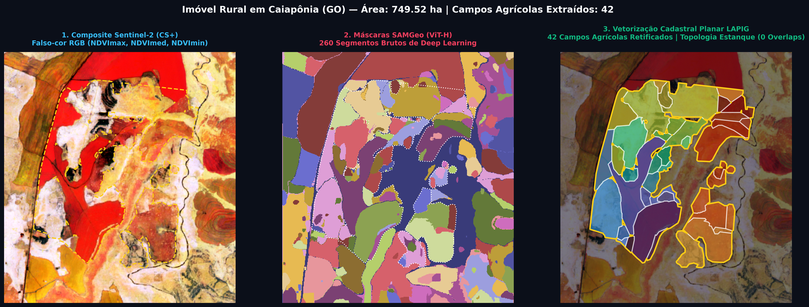
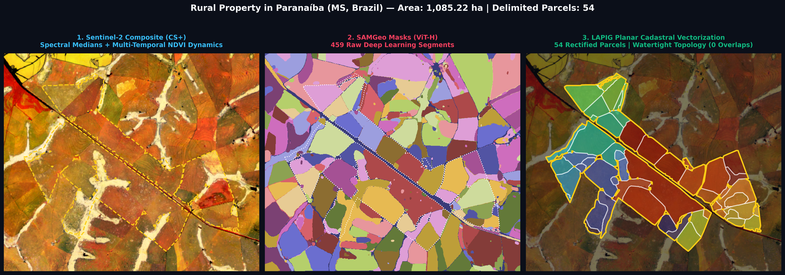
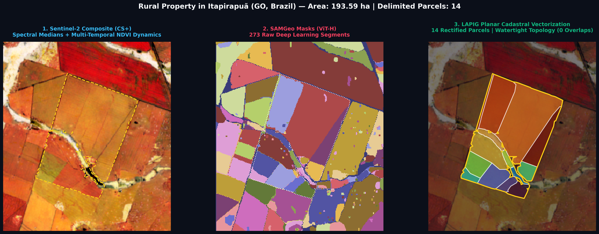

# 🛰️ ParcelAnything: Segmentação & Vetorização Cadastral de Parcelas Rurais (LAPIG)

[](https://python.org)
[](https://pytorch.org)
[](https://samgeo.gishat.org)
[](https://earthengine.google.com)
[-success.svg)](#️-3-arquitetura-do-pipeline)
[-orange.svg)](#-2-desempenho--recursos-computacionais)
[](#-2-desempenho--recursos-computacionais)

**Laboratório de Processamento de Imagens e Geoprocessamento (LAPIG / UFG)**  
*O **ParcelAnything** é uma suite modular de alto desempenho dividida em dois modos complementares para extração de parcelas agrícolas e divisórias territoriais com cercas retilíneas (mourão a mourão), topologia planar estanque (Zero Overlaps), validação zonal pelo MapBiomas (10m / 30m) e telemetria contínua de hardware.*

---

## 🗺️ Visão Geral: As Duas Abordagens Consolidadas

O projeto organiza a segmentação e vetorização cadastral de parcelas em **dois modos complementares e independentes**:

```
Vectorization_Pro/
├── 🖱️ interactive_hq_sam/          # MODO 1: INTERATIVO (Human-in-the-Loop)
│   ├── backend/                     # API FastAPI + PyTorch ViT-H na GPU (CUDA)
│   ├── frontend/                    # Interface Web Leaflet com dock de confirmação e refinamento (+/-)
│   └── run_interactive_app.py       # Inicializador: python run_interactive_app.py --port 8088
│
├── ⚙️ lapig_parcel_segmentation/    # MODO 2: AUTOMÁTICO (Batch Pipeline em Lote)
│   ├── pipeline_parcel_segmentation # Orquestrador principal de ponta a ponta
│   ├── roi_resolver.py              # Resolução universal de geometrias (CAR / Shapefile / Coordenadas)
│   ├── s2_mosaic.py                 # Mosaicos temporais Sentinel-2 Harmonized (GEE CS+)
│   ├── sam_segmenter.py             # Inferência SAMGeo ViT-H em grade com controle estrito de VRAM
│   ├── pasture_classifier.py        # Validação zonal MapBiomas pastagem (10m Col 4 / 30m Col 11)
│   ├── cadastral_vectorizer.py      # Grafo Planar Watertight (Zero Overlaps, cercas retilíneas)
│   └── example_run.py               # CLI: python -m lapig_parcel_segmentation.example_run
│
├── 🌐 sentinel2parcel_test/         # SHOWCASE WEB: Demonstração estática pública no GitHub Pages
│   └── (Live em https://vieiramesquita.github.io/sentinel2parcel_test/)
│
├── 🧠 models/                       # Pesos da rede neural (sam_vit_h_4b8939.pth)
├── 📊 results/                      # Vetores gerados (.shp / .gpkg), estatísticas e relatórios de benchmark
└── 📓 run_in_jupyter.ipynb          # Notebook de demonstração e execução interativa do Auto Mode
```

| Critério | 🖱️ Modo Interativo (`interactive_hq_sam/`) | ⚙️ Modo Automático (`lapig_parcel_segmentation/`) |
| :--- | :--- | :--- |
| **Público / Uso** | Operador humano, auditoria, refinamento fino de perímetros complexos | Processamento massivo de fazendas inteiras ou municípios |
| **Intervenção** | **Human-in-the-Loop:** Cliques com pontos positivos (`+`) e negativos (`−`) | **Zero intervenção:** Execução autônoma ponta a ponta |
| **Modelo de IA** | HQ-SAM ViT-H com amostragem pontual interativa e recortes inteligentes | SAMGeo ViT-H com segmentação automática em grade |
| **Interface** | Web (Leaflet dark glassmorphism na porta `8088` com dock neon) | Linha de comando (CLI) ou script Python / Jupyter |
| **Validação** | O operador valida visualmente e clica em "Confirmar Parcela" | Dominância zonal automática pelo MapBiomas (pastagem) |
| **Formatos de Entrada** | Upload de `.kml`, `.kmz`, `.gpkg`, `.geojson`, `.zip` ou Lat/Lon | `.shp`, `.gpkg`, `.fgb`, `.parquet`, Asset GEE ou Lat/Lon |
| **Saídas** | GeoJSON exportável pelo navegador com métricas em tempo real | Shapefiles duplos (`segmentacao_pura` e `pastagem_final`) |

---

## 📸 1. Galeria de Resultados: Do Satélite ao Vetor Cadastral

O **sentinel2parcel** transforma imagens multiespectrais do Sentinel-2 em polígonos vetoriais prontos para SIG e cadastro rural. Ao contrário de abordagens ingênuas de vetorização (como `gdal_polygonize` ou simplificação independente de polígonos), o método utiliza **Grafos Planares** que simplificam arestas compartilhadas, eliminam dentes de serra (degraus de 10m) e garantem **0 sobreposições e 0 frestas (Topologia Watertight)**.

### Caso 1: Imóvel Rural em Caiapônia (GO) — 749,52 ha
> **Destaques:** Segmentação de 42 parcelas retificadas. Preservação precisa da mata ciliar (APP) e corpo d'água ao centro, eliminando completamente os enclaves e ilhas de ruído do Deep Learning.


---

### Caso 2: Imóvel Rural em Paranaíba (MS) — 1.085,22 ha
> **Destaques:** Imóvel de grande extensão cortado diagonalmente por ferrovia e rodovia. O algoritmo respeitou as divisórias estruturais externas e extraiu 54 parcelas retilíneas bem delimitadas.


---

### Caso 3: Imóvel Rural em Itapirapuã (GO) — 193,59 ha
> **Destaques:** Alta paridade com gabarito manual de fazenda piloto. Retificação perfeita de mourão a mourão em divisórias retas de cerca, contornando a drenagem natural no vale.


---

## ⚡ 2. Desempenho & Recursos Computacionais

O **sentinel2parcel** foi submetido a um teste de estresse e auditoria contínua em lote (*stress test batch*) com **21 imóveis rurais** (20 em Goiás e 1 no Mato Grosso do Sul) selecionados em polos de grande extensão territorial, totalizando **49.760,02 hectares** de área perimetral cadastral analisada.

### Visão Geral de Performance Auditada (Hardware: RTX 2080 Ti 11 GB)
* **Volume Cadastral:** **1.861 parcelas agrícolas produtivas** delimitadas (**44.253,17 ha**) e **2.010 parcelas físicas** na segmentação pura (**47.479,02 ha**).
* **Tempo Total de GPU:** **122,81 minutos (~2,05 horas)** de processamento contínuo acumulado.
* **Tempo Médio por Imóvel:** **~5,85 minutos** (~351 s), variando de **2,5 min** em fazendas médias de topografia uniforme a **8 a 9,5 min** em megaprojetos de grande porte (>9.000 a 10.800 ha).
* **Pico de VRAM Alocada:** Média de **6,41 GB**, operando confortavelmente em **6,47 GB** (58,8% da GPU) e com pico máximo de **9,54 GB** (86,7% da GPU) no imóvel de maior extensão territorial (10.828,8 ha em Goiás).
* **Topologia Watertight:** **0 sobreposições e 0 frestas** comprovadas em 100% das 1.861 parcelas geradas.
* **Estabilidade Térmica:** Temperatura da GPU permaneceu controlada (pico registrado de **70 °C** sob carga total de inferência).

### Decomposição do Esforço Computacional (Profiling por Etapa)

| Etapa do Pipeline | Participação (%) | Dispositivo Principal | Tempo Típico por Fazenda |
| :--- | :--- | :--- | :--- |
| **Inferência SAMGeo ViT-H** | **86,2%** | GPU (CUDA / Tensor Cores) | ~5,0 min |
| **Download Mosaico Sentinel-2 (GEE)** | **8,1%** | Rede & Google Cloud API | ~28 s |
| **Classificação Zonal MapBiomas (10m/30m)** | **1,6%** | Google Earth Engine / CPU | ~5,6 s |
| **Vetorização Cadastral e Grafo Planar** | **0,6%** | CPU (Multithread) | **~2,1 s** *(Ultrarrápido)* |

### Auditoria Detalhada dos 21 Imóveis Processados:

| Município | ID Imóvel (CAR) | Área CAR | Parcelas Validadas | Parcelas Puras | Tempo Total | Pico VRAM |
| :--- | :--- | :--- | :--- | :--- | :--- | :--- |
| **Goiás (GO)** | `GO-5208905-F49642881887...` | 10.828,80 ha | 345 | 354 | 8,2 min | 9,54 GB |
| **Nova Crixás (GO)** | `GO-5214838-32EB159D2A3C...` | 9.719,91 ha | 224 | 267 | 1,0 min | 0,01 GB |
| **Jataí (GO)** | `GO-5211909-AD13173067F8...` | 9.107,04 ha | 234 | 248 | 9,5 min | 8,53 GB |
| **Bom Jesus de Goiás (GO)** | `GO-5203500-366A293867A2...` | 4.476,31 ha | 138 | 178 | 9,5 min | 6,47 GB |
| **Britânia (GO)** | `GO-5203807-146172AFEDAF...` | 2.629,80 ha | 75 | 79 | 8,0 min | 6,47 GB |
| **Serranópolis (GO)** | `GO-5220504-AE59920E9ABB...` | 2.114,08 ha | 96 | 99 | 8,7 min | 6,47 GB |
| **Santa Fé de Goiás (GO)** | `GO-5219258-B3304BD38B7B...` | 1.889,02 ha | 119 | 121 | 4,6 min | 6,47 GB |
| **Ipameri (GO)** | `GO-5210109-9C728F04622C...` | 1.763,45 ha | 124 | 134 | 8,6 min | 6,47 GB |
| **Paranaíba (MS)** | `MS-5006309-8DC93A48C242...` | 1.085,22 ha | 54 | 55 | 3,7 min | 6,47 GB |
| **São Francisco de Goiás (GO)** | `GO-5219902-041335F6BCD1...` | 960,44 ha | 74 | 75 | 6,4 min | 6,47 GB |
| **Colinas do Sul (GO)** | `GO-5205521-DA104FC8E15A...` | 896,58 ha | 35 | 43 | 6,7 min | 6,47 GB |
| **Goiás (GO)** | `GO-5208905-08E150868E2A...` | 828,95 ha | 76 | 76 | 2,8 min | 6,47 GB |
| **Caiapônia (GO)** | `GO-5204409-01D1AD1F9586...` | 798,23 ha | 42 | 54 | 2,5 min | 6,47 GB |
| **Iaciara (GO)** | `GO-5209903-C8653C1E6389...` | 532,20 ha | 32 | 32 | 6,4 min | 6,47 GB |
| **Edéia (GO)** | `GO-5207402-1D40C8AAD650...` | 530,02 ha | 45 | 45 | 3,4 min | 6,47 GB |
| **Jussara (GO)** | `GO-5212204-38A49ED0A118...` | 514,25 ha | 29 | 29 | 2,5 min | 6,47 GB |
| **Jussara (GO)** | `GO-5212204-0B3CAD6C8F1D...` | 420,28 ha | 42 | 42 | 7,9 min | 6,47 GB |
| **Crixás (GO)** | `GO-5206404-499D0D75A139...` | 233,81 ha | 37 | 37 | 5,8 min | 6,47 GB |
| **Itapirapuã (GO)** | `GO-5211008-46C08C6235D7...` | 193,59 ha | 14 | 14 | 3,1 min | 6,47 GB |
| **Luziânia (GO)** | `GO-5212501-89730760C68B...` | 167,76 ha | 16 | 17 | 6,4 min | 6,47 GB |
| **Goiânia (GO)** | `GO-5208707-4045057E90C9...` | 70,28 ha | 10 | 11 | 7,1 min | 6,47 GB |

> **💡 Gerenciamento Contínuo de Memória de Vídeo (Zero VRAM Leak):**  
> A rotina [`clear_gpu_memory()`](lapig_parcel_segmentation/sam_segmenter.py) é acionada compulsória e automaticamente ao término de cada imóvel, deletando explicitamente tensores do `SamGeo`, invocando `gc.collect()`, liberando o *caching allocator* do PyTorch (`torch.cuda.empty_cache()`) e limpando blocos IPC (`torch.cuda.ipc_collect()`). Isso garante que cada imóvel inicie com **0 MB de VRAM residual**.

---

## 🏗️ 3. Arquitetura do Pipeline

```
                   Entrada da Área de Interesse (Universal ROI)
       ┌────────────────────────┬────────────────────────┬────────────────────────┐
       │  Arquivo Local         │  Asset Earth Engine    │  Coordenada            │
       │  .shp, .gpkg, .fgb,    │  'projects/...' ou     │  (lat, lon) ->         │
       │  .parquet, .geojson    │  ee.FeatureCollection  │  Busca no CAR GEE      │
       │  (com id_column)       │  (com filtro de ID)    │  (auto-extrai CAR ID)  │
       └───────────┬────────────┴───────────┬────────────┴───────────┬────────────┘
                   └────────────────────────┼────────────────────────┘
                                            │
                                            ▼
                       [Pasta Pré-definida por Imóvel]
                          results/{ID_DO_IMOVEL}/
                                            │
                                            ▼
                                  Google Earth Engine
                          ┌─────────────────────────────────┐
                          │  Sentinel-2 Harmonized (CS+)    │
                          │  Bandas: NDVI max, median, min  │
                          └─────────────────┬───────────────┘
                                            │
                                            ▼
                                 [Módulo: s2_mosaic]
                                            │ (GeoTIFF multi-temporal)
                                            ▼
                             [Módulo: sam_segmenter]
                         (SAMGeo ViT-H com GPU CUDA 8GB/11GB)
                                            │ (Máscaras brutas)
                                            ▼
                          [Módulo: cadastral_vectorizer]
                          ├── Eliminação de buracos/ilhas internas
                          ├── Grafo Planar e Retificação de Cercas Retas
                          └── Reconstrução Estanque (Zero Overlaps)
                                            │
                                            ▼
                     [Recorte Estrito pelo Limite do CAR]
                                            │
         ┌──────────────────────────────────┴──────────────────────────────────┐
         ▼                                                                     ▼
 [CAMADA 1: SEGMENTAÇÃO PURA]                                         [CAMADA 2: FILTRO PASTAGEM]
 Todos os talhões físicos no CAR                                      Apenas talhões de pastagem
 com colunas de auditoria:                                            validados por dominância zonal:
 (pasto_cov, ndvi_med, is_pasto, classe)                              (MapBiomas 10m Col 4 / 30m Col 11)
         │                                                                     │
         ▼                                                                     ▼
 Shapefile: parcelas_segmentacao_pura_{ID}.shp      Shapefile: parcelas_finais_cercas_retas_{ID}.shp
```

---

## 🚀 4. Instalação e Preparação do Ambiente

### 4.1. Pré-requisitos de Sistema
- **Sistema Operacional:** Linux (Ubuntu 22.04+) ou Windows 11 com WSL 2
- **Python:** Versão 3.10 ou superior
- **GPU NVIDIA:** Mínimo de 8 GB VRAM (recomendado 11 GB+, ex: RTX 2080 Ti, RTX 3060 12GB, RTX 4070+)
- **Google Earth Engine:** Conta habilitada com autenticação ativa via CLI

### 4.2. Instalação Passo a Passo

```bash
# 1. Clone o repositório
git clone https://github.com/vieiramesquita/sentinel2parcel.git
cd sentinel2parcel

# 2. Crie e ative um ambiente virtual
python -m venv venv
source venv/bin/activate  # No Windows: venv\Scripts\activate

# 3. Instale PyTorch com suporte a CUDA 11.8 ou 12.1
pip install torch torchvision --index-url https://download.pytorch.org/whl/cu118

# 4. Instale as bibliotecas geoespaciais e utilitárias
pip install segment-geospatial earthengine-api geopandas shapely rasterio matplotlib pandas duckdb psutil plotly uvicorn fastapi pydantic pyproj pillow

# 5. Autentique sua conta no Google Earth Engine
earthengine authenticate
```

### 4.3. Download dos Pesos do Modelo SAM (ViT-H)
O arquivo de pesos do modelo SAM ViT-H (`sam_vit_h_4b8939.pth` - ~2.5 GB) deve residir na pasta `models/`:
```bash
mkdir -p models
# Download direto dos pesos oficiais do Meta AI:
curl -o models/sam_vit_h_4b8939.pth https://dl.fbaipublicfiles.com/segment_anything/sam_vit_h_4b8939.pth
```

---

## ⚙️ 5. Como Usar o Modo Automático em Lote (`lapig_parcel_segmentation`)

O modo automático é executado via linha de comando (CLI) pelo script [`example_run.py`](lapig_parcel_segmentation/example_run.py) ou diretamente como biblioteca Python.

### 5.1. Dicionário de Parâmetros da Linha de Comando

| Argumento | Tipo | Padrão | Descrição |
| :--- | :--- | :--- | :--- |
| `--input` | `str` | `None` | Caminho do arquivo vetorial (`.shp`, `.gpkg`, `.fgb`, `.parquet`), asset do EE ou coordenada `"lat, lon"`. |
| `--coord` | `str` | `None` | Coordenada geográfica `"lat, lon"` para busca e extração automática do CAR no Earth Engine. |
| `--id-col` | `str` | `None` | Nome da coluna que identifica o imóvel no arquivo vetorial (ex: `cod_imovel`, `gid`, `id`). |
| `--id-val` | `str` | `None` | Código do imóvel específico a ser processado (filtra o arquivo vetorial). |
| `--all` | `flag` | `False` | Executa o processamento em lote sequencial para **todos** os imóveis do arquivo vetorial. |
| `--limit` | `int` | `None` | Limita o número de imóveis a processar no lote (ideal para testes rápidos, ex: `--limit 2`). |
| `--list-ids` | `flag` | `False` | Imprime todos os IDs disponíveis no arquivo vetorial e encerra a execução. |
| `--year` | `int` | `2025` | Ano de referência para composição do mosaico Sentinel-2 e máscara MapBiomas. |
| `--collection` | `str` | `10m` | Coleção MapBiomas: `10m` (Sentinel-2 Col 4) ou `30m` (Landsat Col 11). |
| `--straight-tol` | `float` | `22.0` | Tolerância de retificação de cercas em metros (quanto maior, mais retas as divisórias). |
| `--min_area` | `float` | `2.0` | Área mínima da parcela em hectares (polígonos menores são absorvidos pelos vizinhos). |
| `--no-pasture-filter`| `flag`| `False` | Desabilita o filtro temático do MapBiomas e gera apenas a segmentação física pura de todos os talhões. |
| `--output-dir` | `str` | `results` | Diretório raiz para salvar as subpastas e relatórios de cada imóvel. |
| `--project` | `str` | `None` | ID do projeto Google Earth Engine (opcional; usa o padrão autenticado). |

---

### 5.2. Exemplos Práticos de Execução

#### Cenário A: Processar um imóvel específico a partir de um GeoPackage do CAR
```bash
python -m lapig_parcel_segmentation.example_run \
    --input "car_goias_area_imovel_epsg4674_hottest.gpkg" \
    --id-col "cod_imovel" \
    --id-val "GO-5204409-01D1AD1F9586415E9D46BF93115D27DF" \
    --year 2025 \
    --straight-tol 22.0
```

#### Cenário B: Processar uma propriedade apenas fornecendo sua coordenada GPS
O pipeline busca a coordenada no catálogo oficial do CAR no Earth Engine, identifica o perímetro da fazenda e executa a segmentação completa:
```bash
python -m lapig_parcel_segmentation.example_run \
    --coord "-16.1234, -50.5678" \
    --year 2025 \
    --min_area 2.0
```

#### Cenário C: Listar os imóveis presentes no seu arquivo antes de rodar
```bash
python -m lapig_parcel_segmentation.example_run \
    --input "car_goias_area_imovel_epsg4674_hottest.gpkg" \
    --id-col "cod_imovel" \
    --list-ids
```

#### Cenário D: Execução em Lote para TODOS os imóveis com Shapefile Consolidado
```bash
python -m lapig_parcel_segmentation.example_run \
    --input "car_goias_area_imovel_epsg4674_hottest.gpkg" \
    --id-col "cod_imovel" \
    --all
```
*Ao final do lote, o pipeline consolida automaticamente:*
- `results/parcelas_todos_imoveis_consolidados.shp` (Todas as parcelas de pastagem de todas as fazendas unificadas).
- `results/parcelas_todos_imoveis_segmentacao_pura.shp` (Segmentação física pura de todos os imóveis).
- `results/relatorio_benchmark_hardware_lote.json` e `.txt` (Resumo consolidado de telemetria de hardware).

#### Cenário E: Rodar em Modo Segmentação Pura (Sem descarte de matas/lavouras)
Útil para quem deseja mapear todos os talhões da fazenda independente do uso da terra:
```bash
python -m lapig_parcel_segmentation.example_run \
    --input "car_goias_area_imovel_epsg4674_hottest.gpkg" \
    --id-col "cod_imovel" \
    --id-val "GO-5204409-01D1AD1F9586415E9D46BF93115D27DF" \
    --no-pasture-filter
```

---

### 5.3. Como Utilizar Diretamente no Código Python

```python
from lapig_parcel_segmentation import run_analysis_lapig

# Executa o pipeline completo programaticamente
gdf_pasto, shp_pasto, gdf_puro, shp_puro = run_analysis_lapig(
    input_target="car_goias_area_imovel_epsg4674_hottest.gpkg",
    id_column="cod_imovel",
    id_value="GO-5204409-01D1AD1F9586415E9D46BF93115D27DF",
    year=2025,
    min_area_ha=2.0,
    straight_tol=22.0,
    filter_by_pasture=True,
    enable_benchmark=True
)

print(f"Parcelas de pasto confirmadas: {len(gdf_pasto)}")
print(f"Arquivo gerado: {shp_pasto}")
```

---

## 🖱️ 6. Como Usar o Modo Interativo Human-in-the-Loop (`interactive_hq_sam`)

O modo interativo foi desenhado para **operações assistidas por inteligência visual**. É ideal para operadores humanos auditarem divisórias de pastagem, corrigirem cercas duvidosas ou desenharem talhões complexos com resposta instantânea da IA.

### 6.1. Inicialização do Servidor Local

No terminal do projeto:
```bash
python interactive_hq_sam/run_interactive_app.py --port 8088
```
Acesse no navegador:
👉 **`http://localhost:8088/`**

---

### 6.2. Fluxo de Trabalho Passo a Passo

```
  1. Carregar ROI          2. Amostragem           3. Validação          4. Topologia Estanque
┌──────────────────┐    ┌──────────────────┐    ┌─────────────────┐    ┌────────────────────────┐
│ - Upload KML/KMZ │    │ - Clique Pos (+) │    │ - Conferir Área │    │ - Regularizar Cercas   │
│ - Código CAR     │ -> │ - Clique Neg (-) │ -> │ - "Confirmar    │ -> │   (Watertight Graph)   │
│ - Lat / Lon      │    │   (Bisseção Per- │    │    Parcela"     │    │ - "Exportar GeoJSON"   │
│ - Demo Pre-sets  │    │    pendicular)   │    │                 │    │                        │
└──────────────────┘    └──────────────────┘    └─────────────────┘    └────────────────────────┘
```

1. **Carregar a Região de Interesse (ROI):**
   - **Upload de Arquivo Vetorial:** Arraste e solte ou selecione arquivos `.kml`, `.kmz`, `.gpkg`, `.geojson` ou `.zip` (Shapefile). Geometrias com altitude 3D são automaticamente sanitizadas em 2D.
   - **Código do CAR:** Digite o código do imóvel para download em tempo real do mosaico multitemporal Sentinel-2.
   - **Coordenada Lat/Lon:** Forneça a latitude e longitude central da fazenda.
   - **Fazendas Pré-carregadas:** Escolha uma das propriedades demonstrativas no menu lateral.

2. **Amostragem com Pontos Positivos e Negativos:**
   - **Ponto Positivo (`+` - Verde):** Clique no interior do pasto ou talhão para segmentar a feição desejada. Múltiplos pontos positivos unem áreas contíguas.
   - **Ponto Negativo (`−` - Vermelho):** Clique sobre represas, sedes, áreas florestais ou pastos vizinhos. O algoritmo calcula a **bisseção perpendicular** entre a semente positiva e a negativa, seccionando a divisa instantaneamente.

3. **Confirmação da Parcela:**
   - O contorno tracejado neon ciano exibe a proposta do modelo com cálculo de área em hectares (`ha`) e pontuação de confiança.
   - Clique no botão **`Confirmar Parcela`** no dock inferior para salvar o polígono no cadastro da sessão.

4. **Refinamento e Edição de Parcelas Já Salvas:**
   - Para ajustar uma parcela já confirmada, clique sobre ela no mapa ou na lista lateral. Novos cliques positivos e negativos refinarão imediatamente sua geometria.

5. **Regularização Topológica e Exportação:**
   - Clique no botão **`⚡ Regularizar Topologia (Watertight)`** para converter todas as parcelas salvas em um grafo planar com arestas compartilhadas e retificadas de mourão a mourão (0% de sobreposição garantido).
   - Clique em **`Exportar GeoJSON`** para baixar o arquivo cadastral pronto para importação no QGIS ou ArcGIS.

---

## 📂 7. Estrutura das Pastas e Dicionário de Atributos

### Estrutura de Arquivos Gerada por Imóvel em `results/{ID}/`:
```
results/GO-5204409-01D1AD1F9586415E9D46BF93115D27DF/
├── parcelas_segmentacao_pura_GO-5204409...shp      # Todos os talhões físicos no CAR
├── parcelas_finais_cercas_retas_GO-5204409...shp   # Apenas parcelas de pastagem validadas
├── nao_pastagem_auditoria.shp                      # Áreas descartadas (matas, lavouras, água)
├── s2_ndvi_rgb.tif                                 # Mosaico espectral Sentinel-2 CS+
├── relatorio_benchmark_hardware.json               # Telemetria estruturada de hardware
└── relatorio_benchmark_hardware.txt                # Relatório legível de consumo de VRAM e CPU
```

### Dicionário de Atributos das Camadas Vetoriais:

| Campo | Tipo | Descrição |
| :--- | :--- | :--- |
| `id_parcela` | `Integer` | Identificador sequencial único da parcela dentro do imóvel. |
| `cod_car` | `String` | Código identificador oficial do imóvel rural no CAR. |
| `area_ha` | `Float` | Área calculada da parcela em hectares (`ha`). |
| `perim_m` | `Float` | Perímetro do polígono da parcela em metros. |
| `pasto_cov` | `Float` | Percentual de cobertura de pastagem da parcela segundo o MapBiomas (0.00 a 1.00). |
| `ndvi_med` | `Float` | Mediana do NDVI espectral da parcela no período de análise. |
| `is_pasto` | `Integer` | `1` se aprovado como pastagem (dominância $\ge$ 35%), `0` se classe alternativa. |
| `classe` | `String` | Descrição textual da classe: `'Pasto'` ou `'Outros (Mata/APP/Lavoura)'`. |

---

## 🛡️ 8. Segurança, Governança & Boas Práticas

- **Proteção de Informações Sensíveis:** O repositório conta com uma skill global de auditoria de segurança preventiva (`git-sensitive-guard`) em `~/.gemini/config/skills/git-sensitive-guard/`, que bloqueia automaticamente o envio acidental de arquivos confidenciais, artigos acadêmicos locais (`paper/`), credenciais (`.env`, chaves de API, certificados) ou skills proprietárias.
- **Registro Cumulativo de Decisões:** Todas as decisões arquiteturais, padrões terminológicos e regras de projeto estão documentadas no arquivo [PROJECT_DECISIONS.md](PROJECT_DECISIONS.md).

---

## 👥 Créditos & Equipe

* **Laboratório de Processamento de Imagens e Geoprocessamento (LAPIG)** — Universidade Federal de Goiás (UFG)
* **Desenvolvimento e Otimização:** Vinícius Mesquita & Equipe LAPIG
* **Suporte de IA:** Antigravity (Google DeepMind)
