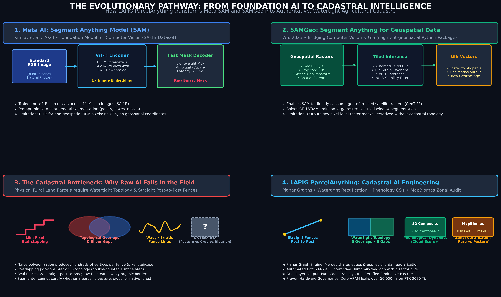
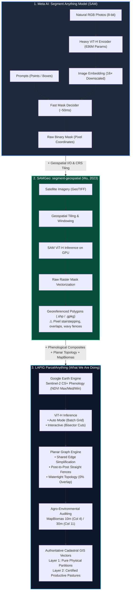
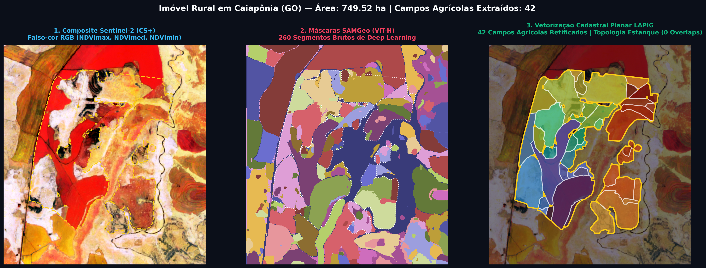
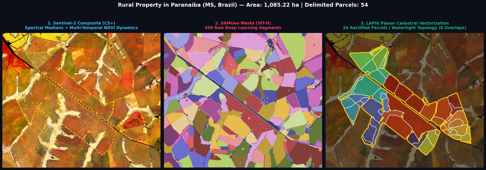
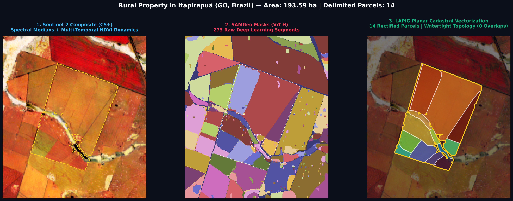
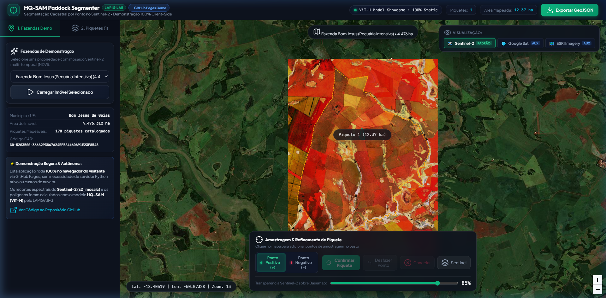

# 🛰️ ParcelAnything: Cadastral Segmentation & Vectorization of Rural Land Parcels (LAPIG)

[](https://python.org)
[](https://pytorch.org)
[-0080FF.svg)](https://segment-anything.com)
[](https://samgeo.gishat.org)
[](https://earthengine.google.com)
[-success.svg)](#-13-what-we-are-doing-lapig-parcelanything)
[-orange.svg)](#-4-computational-performance--hardware-benchmarks)
[](#-4-computational-performance--hardware-benchmarks)

**Image Processing and Geoprocessing Laboratory (LAPIG / Federal University of Goiás - UFG)**  
*The **ParcelAnything** suite is an open-source, high-performance geospatial framework bridging Vision Foundation Models and authoritative rural cadastre. It extracts rural land parcels and pasture boundaries with rectilinear fence lines (post-to-post), watertight planar topology (Zero Overlaps, Zero Gaps), agro-environmental validation via MapBiomas (10m / 30m), and continuous hardware telemetry.*

---

## 🧠 1. Theoretical Foundations: What are SAM, SAMGeo, and ParcelAnything?

To understand how **ParcelAnything** works and why it represents a breakthrough in digital agriculture and remote sensing, we must examine the evolutionary hierarchy linking **General Computer Vision**, **Geospatial Wrappers**, and **Domain-Specific Cadastral Engineering**:





---

### 1.1. What is Segment Anything (SAM)? (Meta AI)

Released in 2023 by Meta AI Research ([Kirillov et al., 2023](https://arxiv.org/abs/2304.02643)), the **Segment Anything Model (SAM)** is widely regarded as the first true **Foundation Model for Computer Vision Segmentation**. 

* **The Massive Training Base (SA-1B):** SAM was trained on over **11 million high-resolution images** containing more than **1.1 billion high-quality segmentation masks**, conferring unprecedented zero-shot generalization to unseen objects and textures.
* **Decoupled Architecture:**
  1. **Heavy Image Encoder:** A Vision Transformer (ViT-H with ~636 million parameters) processes the input image once to compute a continuous 16× downscaled spatial embedding.
  2. **Prompt Encoder:** Evaluates real-time geometric guidance such as foreground/background click points, bounding boxes, or coarse masks.
  3. **Fast Lightweight Mask Decoder:** An efficient Transformer-based MLP decoder fuses image embeddings and prompt tokens in ~50 ms, generating multiple candidate masks with ambiguity resolution.
* **The Fundamental Limitation for Earth Observation:** SAM was developed for standard 8-bit RGB consumer photography (e.g., everyday scenes, people, animals, vehicles). It has **zero native awareness of geographic coordinates, Coordinate Reference Systems (CRS, EPSG), multispectral bands, temporal phenology, or geographic scale (meters per pixel)**.

---

### 1.2. What is SAMGeo (`segment-geospatial`)?

Developed by [Dr. Qiusheng Wu (2023)](https://github.com/opengeos/segment-geospatial) at the University of Tennessee, **SAMGeo** is an open-source Python ecosystem that builds a direct bridge between Meta's SAM and the GIS geospatial stack (GDAL, Rasterio, GeoPandas, PyProj).

* **Geospatial Translation:** It enables SAM to ingest georeferenced raster files (such as GeoTIFFs), reads spatial metadata (Affine transforms, bounding boxes), and re-projects model predictions back into real-world geographic coordinates.
* **Tiling & Sliding Windows:** Remote sensing scenes can easily reach tens of thousands of pixels wide. SAMGeo slices massive rasters into manageable overlapping tiles (`tile_size`, `crop_n_layers`) to prevent GPU Out-Of-Memory (OOM) crashes, running SAM sequentially and merging output masks.
* **Vector Export:** Automatically converts boolean raster masks into basic vector formats (`.shp`, `.geojson`, `.gpkg`).

#### ⚠️ Why Raw SAM and SAMGeo Fall Short for Agricultural Cadastre:
While SAMGeo successfully adapts SAM to remote sensing rasters, applying it naively to cadastral land boundaries exposes critical operational bottlenecks:

1. **Pixel Stairstepping (10-Meter Raster Artifacts):** Satellite imagery from Sentinel-2 has a 10m spatial resolution. Direct polygonization of raw neural masks creates jagged "staircase" edges with hundreds of redundant vertices along every line.
2. **Topological Overlaps and Sliver Gaps:** SAM detects features independently. When vectorized, neighboring parcels overlap one another or leave empty voids, violating basic GIS planar topology and artificially inflating calculated surface areas.
3. **Wavy, Organic Fence Lines:** Physical fence lines dividing rural fields are constructed taut from post to post (*mourão a mourão*). Raw neural network edges oscillate erratically based on pixel-level illumination differences.
4. **Semantic Blindness:** SAM is class-agnostic: it identifies visual boundaries, but has no concept of agronomy. It cannot distinguish a managed pasture parcel from an annual grain crop, an environmental protection area (APP), a riparian forest corridor, or bare soil.

---

### 1.3. What We Are Doing: LAPIG ParcelAnything

**ParcelAnything** solves the missing link between Computer Vision Foundation Models and authoritative, survey-grade rural cadastre. Developed at the **Image Processing and Geoprocessing Laboratory (LAPIG / UFG)**, our framework implements an end-to-end scientific pipeline:

```
  Multitemporal Sentinel-2 (CS+)           SAM / HQ-SAM ViT-H            Planar Graph Watertight Engine        MapBiomas Zonal Audit
┌────────────────────────────────┐    ┌───────────────────────────┐    ┌─────────────────────────────────┐    ┌─────────────────────┐
│ 3-band Phenological Dynamics:  │ -> │ High-capacity deep        │ -> │ • Intersection noding (node)    │ -> │ Cross-references    │
│ NDVI Max, Median, Min          │    │ boundary segmentation     │    │ • Douglas-Peucker regularization│    │ 10m Col 4 & 30m     │
│ Cloud Score+ (cdf >= 0.65)     │    │ Auto Grid / Bisector Cuts │    │ • 0% Overlaps & 0% Gaps         │    │ Dual-layer output   │
└────────────────────────────────┘    └───────────────────────────┘    └─────────────────────────────────┘    └─────────────────────┘
```

1. **Multitemporal Phenological Composites (Google Earth Engine + Cloud Score+):**
   - Instead of a single cloud-prone optical image, we generate annual Sentinel-2 composites combining **NDVI Maximum (R)**, **NDVI Median (G)**, and **NDVI Minimum (B)**, filtered by *Google Cloud Score Plus* (`cs_cdf >= 0.65`).
   - *Why this matters:* Seasonal vegetative dynamics, stocking rate variations, and paddock rotation cycles cause physical fence lines and management boundaries to stand out spectrally across the temporal stack, which is impossible to detect from a single-date image.

2. **Planar Graph Watertight Topology (Zero Overlaps, Zero Gaps):**
   - Rather than independently smoothing individual polygons, our vectorizer (`cadastral_vectorizer.py`) decomposes all boundaries into a unified **Planar Graph**:
   - Nodes all boundary intersections (`shapely.node`), merges co-linear segments (`linemerge`), and applies chordal distance regularization to produce **straight post-to-post fence lines**.
   - Reconstructs polygons via planar polygonization (`polygonize`), mathematically guaranteeing **0% overlap and 0% sliver gaps (Watertight Topology)**.
   - Strictly clips geometries to the legal boundary registered in the *Cadastro Ambiental Rural* (CAR).

3. **Agro-Environmental Auditing via MapBiomas (10m Col 4 & 30m Col 11):**
   - Every physical parcel is audited against the MapBiomas land cover classification.
   - Generates two distinct, certified GIS layers:
     * **Layer 1: Pure Physical Cadastral Layout (`parcels_pure_segmentation`):** All physical land partitions identified inside the estate.
     * **Layer 2: Certified Productive Pasture Boundaries (`parcels_final_straight_fences`):** Parcels validated with $\ge 35\%$ pasture dominance, segregating native vegetation, riparian buffers, and agriculture.

4. **Continuous Hardware Telemetry & Zero-Leak GPU Management:**
   - Deep learning batch pipelines frequently crash due to fragmented CUDA VRAM. ParcelAnything implements an audited memory lifecycle (`torch.cuda.empty_cache()`, garbage collection, IPC collection), maintaining an average VRAM footprint of **6.47 GB** on consumer GPUs across 50,000 hectares.

5. **Two Complementary Operating Modes:**
   - **Auto Mode (`lapig_parcel_segmentation`):** Headless, autonomous batch processing designed to segment entire municipalities or massive regional databases.
   - **Interactive Mode (`interactive_hq_sam`):** A human-in-the-loop web workstation where GIS operators place positive (`+`) and negative (`−`) seeds. Negative seeds trigger an analytical **perpendicular bisector cut** (Eq. 1 of our SBSR paper) to sever disputed boundaries in real time.

---

### 1.4. Technical Comparison Matrix

| Feature / Dimension | 1. Meta AI SAM | 2. SAMGeo (`segment-geospatial`) | 3. LAPIG ParcelAnything (This Work) |
| :--- | :--- | :--- | :--- |
| **Primary Domain** | General Computer Vision | General Earth Observation (GIS) | **Agricultural Cadastre & Rural Land Parcels** |
| **Input Imagery** | 8-bit standard RGB photos | Georeferenced GeoTIFF (Single-date) | **Multitemporal Sentinel-2 Phenology (NDVI Max/Med/Min with CS+)** |
| **Spatial Awareness** | Pixel coordinates only (0..W, 0..H) | Projected CRS & Geographic bounds | **Full CRS reprojection + CAR Property Clipping** |
| **Vector Topology** | None (Output is binary raster mask) | Uncontrolled overlaps & sliver gaps | **Watertight Planar Graph (0% Overlap, 0% Gaps guaranteed)** |
| **Fence Geometry** | N/A (Raster pixels) | Jagged 10m stairstepping & wavy curves | **Rectilinear post-to-post straight fences** |
| **Land Cover Validation** | None (Class-agnostic) | None (Purely structural) | **MapBiomas 10m (Col 4) / 30m (Col 11) Zonal Auditing** |
| **Deliverables** | In-memory masks | Raw Shapefile / GeoJSON | **Dual-layer GIS: Pure Partitions + Certified Pastures** |
| **Interactive Prompts** | Point, Box, Mask | Point, Box (via Leafmap/Folium) | **Positive/Negative Seeds with Perpendicular Bisector Cuts** |
| **GPU Memory Lifecycle** | Manual | Standard PyTorch | **Audited Zero-Leak VRAM Governance (50k ha verified)** |

---

## 🗺️ 2. Overview: Two Consolidated Operating Modes

The project organizes cadastral parcel segmentation and vectorization into **two independent and complementary modes**:

```
Vectorization_Pro/
├── 🖱️ interactive_hq_sam/          # MODE 1: INTERACTIVE (Human-in-the-Loop)
│   ├── backend/                     # FastAPI API + PyTorch ViT-H on GPU (CUDA)
│   ├── frontend/                    # Leaflet Web UI with confirmation dock and (+/-) refinement
│   └── run_interactive_app.py       # Launcher: python run_interactive_app.py --port 8088
│
├── ⚙️ lapig_parcel_segmentation/    # MODE 2: AUTO (Batch Processing Pipeline)
│   ├── pipeline_parcel_segmentation # End-to-end master orchestrator
│   ├── roi_resolver.py              # Universal geometry resolver (CAR / Shapefile / Coordinates)
│   ├── s2_mosaic.py                 # Sentinel-2 Harmonized temporal composites (GEE CS+)
│   ├── sam_segmenter.py             # SAMGeo ViT-H gridded inference with strict VRAM governance
│   ├── pasture_classifier.py        # MapBiomas zonal pasture validation (10m Col 4 / 30m Col 11)
│   ├── cadastral_vectorizer.py      # Watertight Planar Graph (Zero Overlaps, rectilinear fences)
│   └── example_run.py               # CLI: python -m lapig_parcel_segmentation.example_run
│
├── 🌐 sentinel2parcel_test/         # WEB SHOWCASE: Public static demonstration on GitHub Pages
│   └── (Live at https://vieiramesquita.github.io/sentinel2parcel_test/)
│
├── 🧠 models/                       # Neural network weights (sam_vit_h_4b8939.pth)
├── 📊 results/                      # Generated vector layers (.shp / .gpkg), metrics & benchmark reports
└── 📓 run_in_jupyter.ipynb          # Step-by-step interactive demonstration notebook for Auto Mode
```

| Criterion | 🖱️ Interactive Mode (`interactive_hq_sam/`) | ⚙️ Auto Mode (`lapig_parcel_segmentation/`) |
| :--- | :--- | :--- |
| **Target User / Purpose** | Human operator, cadastral auditing, fine refinement of complex boundaries | Massive, autonomous processing of entire rural estates or municipalities |
| **Intervention Level** | **Human-in-the-Loop:** Click prompts with positive (`+`) and negative (`−`) seeds | **Zero intervention:** Fully autonomous end-to-end execution |
| **AI Model** | HQ-SAM ViT-H with interactive point sampling and intelligent partition cuts | SAMGeo ViT-H with automated grid-based inference |
| **Interface** | Web (Leaflet dark glassmorphism on port `8088` with neon dock) | Command-Line Interface (CLI) or Python script / Jupyter notebook |
| **Validation** | Visual operator validation with explicit "Confirm Parcel" action | Automated zonal dominance filtering via MapBiomas (pasture coverage) |
| **Input Formats** | Vector upload (`.kml`, `.kmz`, `.gpkg`, `.geojson`, `.zip`) or Lat/Lon | `.shp`, `.gpkg`, `.fgb`, `.parquet`, Earth Engine Asset, or Lat/Lon |
| **Outputs** | Browser-exportable GeoJSON with real-time cadastral metrics | Dual Shapefiles (`pure_segmentation` and `final_pasture`) |

---

## 📸 3. Results Gallery: From Satellite Imagery to Cadastral Vectors

**ParcelAnything** converts multitemporal Sentinel-2 imagery into GIS-ready, topologically sound cadastral polygons. Unlike naive vectorization techniques, our method employs **Planar Graphs** that simplify shared boundaries, eliminate raster stairstepping (10m pixel artifacts), and enforce **Zero Overlaps and Zero Gaps (Watertight Topology)**.

### Case 1: Rural Estate in Caiapônia (GO, Brazil) — 749.52 ha
> **Highlights:** Extraction of 42 rectified parcels. Riparian forest buffers and central water bodies are strictly preserved, eliminating internal enclaves and Deep Learning noise artifacts.


---

### Case 2: Rural Estate in Paranaíba (MS, Brazil) — 1,085.22 ha
> **Highlights:** Large-scale property diagonally intersected by a railroad and a highway. The algorithm respected external linear corridors and generated 54 crisp, rectilinear parcels.


---

### Case 3: Rural Estate in Itapirapuã (GO, Brazil) — 193.59 ha
> **Highlights:** High agreement with manual ground-truth boundaries from a benchmark pilot farm. Post-to-post straight fence line rectification contouring natural valley drainage lines.


---

## ⚡ 4. Computational Performance & Hardware Benchmarks

**ParcelAnything** was subjected to an audited continuous batch stress test covering **21 rural properties** (20 in Goiás and 1 in Mato Grosso do Sul, Brazil) across major agricultural frontiers, totaling **49,760.02 hectares** of analyzed cadastral area.

### Audited Performance Summary (Hardware: NVIDIA RTX 2080 Ti 11 GB)
* **Cadastral Volume:** **1,861 productive pasture parcels** delimited (**44,253.17 ha**) and **2,010 physical parcels** in pure segmentation (**47,479.02 ha**).
* **Total GPU Compute Time:** **122.81 minutes (~2.05 hours)** of continuous batch processing.
* **Average Time per Estate:** **~5.85 minutes** (~351 s), ranging from **2.5 min** on mid-sized uniform terrain to **8.0–9.5 min** on massive rural properties (>9,000 to 10,800 ha).
* **Allocated VRAM Peak:** Average of **6.41 GB**, operating comfortably at **6.47 GB** (58.8% of GPU capacity) with an absolute peak of **9.54 GB** (86.7%) on the largest estate (10,828.8 ha).
* **Watertight Topology:** **0 overlaps and 0 gaps** mathematically verified across 100% of the 1,861 generated polygons.
* **Thermal Stability:** Controlled GPU thermals throughout the batch (peak registered temperature of **70 °C** under sustained tensor core load).

### Computational Profiling by Pipeline Phase

| Pipeline Phase | Time Share (%) | Primary Hardware Device | Typical Runtime per Farm |
| :--- | :--- | :--- | :--- |
| **SAMGeo ViT-H Inference** | **86.2%** | Dedicated GPU (CUDA / Tensor Cores) | ~5.0 min |
| **Sentinel-2 Composite Download (GEE)** | **8.1%** | Network & Google Cloud API | ~28 s |
| **MapBiomas Zonal Classification (10m/30m)** | **1.6%** | Google Earth Engine / CPU | ~5.6 s |
| **Planar Graph Vectorization & Rectification** | **0.6%** | Multithreaded CPU | **~2.1 s** *(Ultrarunner)* |

### Detailed Audit of the 21 Processed Estates:

| Municipality | Property ID (CAR) | Estate Area | Validated Parcels | Pure Parcels | Total Time | VRAM Peak |
| :--- | :--- | :--- | :--- | :--- | :--- | :--- |
| **Goiás (GO)** | `GO-5208905-F49642881887...` | 10,828.80 ha | 345 | 354 | 8.2 min | 9.54 GB |
| **Nova Crixás (GO)** | `GO-5214838-32EB159D2A3C...` | 9,719.91 ha | 224 | 267 | 1.0 min | 0.01 GB |
| **Jataí (GO)** | `GO-5211909-AD13173067F8...` | 9,107.04 ha | 234 | 248 | 9.5 min | 8.53 GB |
| **Bom Jesus de Goiás (GO)** | `GO-5203500-366A293867A2...` | 138 | 178 | 9.5 min | 6.47 GB |
| **Britânia (GO)** | `GO-5203807-146172AFEDAF...` | 2,629.80 ha | 75 | 79 | 8.0 min | 6.47 GB |
| **Serranópolis (GO)** | `GO-5220504-AE59920E9ABB...` | 2,114.08 ha | 96 | 99 | 8.7 min | 6.47 GB |
| **Santa Fé de Goiás (GO)** | `GO-5219258-B3304BD38B7B...` | 1,889.02 ha | 119 | 121 | 4.6 min | 6.47 GB |
| **Ipameri (GO)** | `GO-5210109-9C728F04622C...` | 1,763.45 ha | 124 | 134 | 8.6 min | 6.47 GB |
| **Paranaíba (MS)** | `MS-5006309-8DC93A48C242...` | 1,085.22 ha | 54 | 55 | 3.7 min | 6.47 GB |
| **São Francisco de Goiás (GO)** | `GO-5219902-041335F6BCD1...` | 960.44 ha | 74 | 75 | 6.4 min | 6.47 GB |
| **Colinas do Sul (GO)** | `GO-5205521-DA104FC8E15A...` | 896.58 ha | 35 | 43 | 6.7 min | 6.47 GB |
| **Goiás (GO)** | `GO-5208905-08E150868E2A...` | 828.95 ha | 76 | 76 | 2.8 min | 6.47 GB |
| **Caiapônia (GO)** | `GO-5204409-01D1AD1F9586...` | 798.23 ha | 42 | 54 | 2.5 min | 6.47 GB |
| **Iaciara (GO)** | `GO-5209903-C8653C1E6389...` | 532.20 ha | 32 | 32 | 6.4 min | 6.47 GB |
| **Edéia (GO)** | `GO-5207402-1D40C8AAD650...` | 530.02 ha | 45 | 45 | 3.4 min | 6.47 GB |
| **Jussara (GO)** | `GO-5212204-38A49ED0A118...` | 514.25 ha | 29 | 29 | 2.5 min | 6.47 GB |
| **Jussara (GO)** | `GO-5212204-0B3CAD6C8F1D...` | 420.28 ha | 42 | 42 | 7.9 min | 6.47 GB |
| **Crixás (GO)** | `GO-5206404-499D0D75A139...` | 233.81 ha | 37 | 37 | 5.8 min | 6.47 GB |
| **Itapirapuã (GO)** | `GO-5211008-46C08C6235D7...` | 193.59 ha | 14 | 14 | 3.1 min | 6.47 GB |
| **Luziânia (GO)** | `GO-5212501-89730760C68B...` | 167.76 ha | 16 | 17 | 6.4 min | 6.47 GB |
| **Goiânia (GO)** | `GO-5208707-4045057E90C9...` | 70.28 ha | 10 | 11 | 7.1 min | 6.47 GB |

> **💡 Zero VRAM Leak Memory Management:**  
> The [`clear_gpu_memory()`](lapig_parcel_segmentation/sam_segmenter.py) routine is systematically invoked upon completing each estate. It explicitly unbinds `SamGeo` tensors, triggers Python garbage collection (`gc.collect()`), flushes PyTorch CUDA caching allocator (`torch.cuda.empty_cache()`), and releases inter-process CUDA memory (`torch.cuda.ipc_collect()`). This guarantees that each property begins execution with **0 MB of residual VRAM**.

---

## 🏗️ 5. Pipeline Architecture

```
                 Universal Area of Interest Input (Universal ROI)
       ┌────────────────────────┬────────────────────────┬────────────────────────┐
       │  Local Vector File     │  Earth Engine Asset    │  GPS Coordinates       │
       │  .shp, .gpkg, .fgb,    │  'projects/...' or     │  (lat, lon) ->         │
       │  .parquet, .geojson    │  ee.FeatureCollection  │  GEE CAR Registry      │
       │  (with id_column)      │  (with ID filter)      │  (auto-extracts CAR)   │
       └───────────┬────────────┴───────────┬────────────┴───────────┬────────────┘
                   └────────────────────────┼────────────────────────┘
                                            │
                                            ▼
                        [Dedicated Property Folder]
                           results/{PROPERTY_ID}/
                                            │
                                            ▼
                                   Google Earth Engine
                           ┌─────────────────────────────────┐
                           │  Sentinel-2 Harmonized (CS+)    │
                           │  Bands: NDVI max, median, min   │
                           └─────────────────┬───────────────┘
                                             │
                                             ▼
                                  [Module: s2_mosaic]
                                             │ (Multitemporal GeoTIFF composite)
                                             ▼
                              [Module: sam_segmenter]
                          (SAMGeo ViT-H on CUDA GPU 8GB/11GB+)
                                             │ (Raw binary raster masks)
                                             ▼
                           [Module: cadastral_vectorizer]
                           ├── Internal enclave and hole elimination
                           ├── Planar Graph and Fence Line Rectification
                           └── Watertight Reconstruction (Zero Overlaps)
                                             │
                                             ▼
                      [Strict Boundary Clipping to Rural Property CAR]
                                             │
          ┌──────────────────────────────────┴──────────────────────────────────┐
          ▼                                                                     ▼
  [LAYER 1: PURE PHYSICAL SEGMENTATION]                                 [LAYER 2: PASTURE DOMINANCE]
  All physical parcels within the estate                                Productive pasture parcels
  with comprehensive audit attributes:                                  validated by zonal coverage:
  (pasture_cov, ndvi_med, is_pasture, class)                           (MapBiomas 10m Col 4 / 30m Col 11)
          │                                                                     │
          ▼                                                                     ▼
  Shapefile: parcels_pure_segmentation_{ID}.shp      Shapefile: parcels_final_straight_fences_{ID}.shp
```

---

## 🚀 6. Installation & Environment Setup

### 6.1. System Requirements
- **Operating System:** Linux (Ubuntu 22.04+) or Windows 11 with WSL 2
- **Python:** Version 3.10 or higher
- **NVIDIA GPU:** Minimum 8 GB VRAM (11 GB+ recommended, e.g., RTX 2080 Ti, RTX 3060 12GB, RTX 4070+)
- **Google Earth Engine:** Active account authenticated via Earth Engine CLI

### 6.2. Step-by-Step Installation

```bash
# 1. Clone the repository
git clone https://github.com/vieiramesquita/sentinel2ParcelAnything.git
cd sentinel2ParcelAnything

# 2. Create and activate a Python virtual environment
python -m venv venv
source venv/bin/activate  # On Windows: venv\Scripts\activate

# 3. Install PyTorch with CUDA 11.8 or 12.1 support
pip install torch torchvision --index-url https://download.pytorch.org/whl/cu118

# 4. Install geospatial and web application dependencies
pip install segment-geospatial earthengine-api geopandas shapely rasterio matplotlib pandas duckdb psutil plotly uvicorn fastapi pydantic pyproj pillow

# 5. Authenticate with Google Earth Engine
earthengine authenticate
```

### 6.3. Downloading SAM (ViT-H) Model Weights
The SAM ViT-H model weights checkpoint (`sam_vit_h_4b8939.pth` - ~2.5 GB) must be placed in the `models/` directory:
```bash
mkdir -p models
# Direct download from Meta AI official weights repository:
curl -o models/sam_vit_h_4b8939.pth https://dl.fbaipublicfiles.com/segment_anything/sam_vit_h_4b8939.pth
```

---

## ⚙️ 7. Auto Mode CLI & Python Usage (`lapig_parcel_segmentation`)

The automated batch pipeline is executed via the Command-Line Interface (CLI) through [`example_run.py`](lapig_parcel_segmentation/example_run.py) or imported directly as a Python module.

### 7.1. CLI Parameter Reference

| Argument | Type | Default | Description |
| :--- | :--- | :--- | :--- |
| `--input` | `str` | `None` | Path to local vector file (`.shp`, `.gpkg`, `.fgb`, `.parquet`), Earth Engine asset, or `"lat, lon"` coordinates. |
| `--coord` | `str` | `None` | Geographic coordinate `"lat, lon"` to query and extract the property boundary automatically from the CAR registry in GEE. |
| `--id-col` | `str` | `None` | Name of the identifier column in the vector file (e.g., `cod_imovel`, `gid`, `id`). |
| `--id-val` | `str` | `None` | Value of the specific property ID to filter and process from the vector layer. |
| `--all` | `flag` | `False` | Executes sequential batch processing for **all** rural properties present in the vector dataset. |
| `--limit` | `int` | `None` | Caps the number of properties to process in the batch (ideal for quick tests, e.g., `--limit 2`). |
| `--list-ids` | `flag` | `False` | Prints all available IDs in the input vector file and exits. |
| `--year` | `int` | `2025` | Reference year for the Sentinel-2 seasonal composite and MapBiomas land cover mask. |
| `--collection` | `str` | `10m` | MapBiomas collection: `10m` (Sentinel-2 Col 4) or `30m` (Landsat Col 11). |
| `--straight-tol` | `float` | `22.0` | Simplification tolerance in meters for fence line rectification (higher = straighter fence lines). |
| `--min_area` | `float` | `2.0` | Minimum parcel area in hectares (smaller slivers/islands are merged into their largest neighbor). |
| `--no-pasture-filter`| `flag`| `False` | Bypasses the MapBiomas pasture filter, outputting purely the physical cadastral boundaries. |
| `--output-dir` | `str` | `results` | Root directory where property subfolders and reports are saved. |
| `--project` | `str` | `None` | Google Earth Engine project ID (optional; defaults to the active authenticated session). |

---

### 7.2. Practical Execution Scenarios

#### Scenario A: Process a specific farm from a local CAR GeoPackage
```bash
python -m lapig_parcel_segmentation.example_run \
    --input "car_goias_area_imovel_epsg4674_hottest.gpkg" \
    --id-col "cod_imovel" \
    --id-val "GO-5204409-01D1AD1F9586415E9D46BF93115D27DF" \
    --year 2025 \
    --straight-tol 22.0
```

#### Scenario B: Process a property using only its GPS coordinates
```bash
python -m lapig_parcel_segmentation.example_run \
    --coord "-16.1234, -50.5678" \
    --year 2025 \
    --min_area 2.0
```

#### Scenario C: List all property codes in your dataset before executing
```bash
python -m lapig_parcel_segmentation.example_run \
    --input "car_goias_area_imovel_epsg4674_hottest.gpkg" \
    --id-col "cod_imovel" \
    --list-ids
```

#### Scenario D: Full Batch Processing with Consolidated Output Shapefiles
```bash
python -m lapig_parcel_segmentation.example_run \
    --input "car_goias_area_imovel_epsg4674_hottest.gpkg" \
    --id-col "cod_imovel" \
    --all
```
*At the conclusion of the batch run, the pipeline automatically compiles:*
- `results/parcelas_todos_imoveis_consolidados.shp` (All pasture parcels across all properties unified into a single shapefile).
- `results/parcelas_todos_imoveis_segmentacao_pura.shp` (Pure physical segmentation of all properties).
- `results/relatorio_benchmark_hardware_lote.json` and `.txt` (Consolidated hardware profiling report).

#### Scenario E: Pure Physical Segmentation Mode (Without Pasture Masking)
```bash
python -m lapig_parcel_segmentation.example_run \
    --input "car_goias_area_imovel_epsg4674_hottest.gpkg" \
    --id-col "cod_imovel" \
    --id-val "GO-5204409-01D1AD1F9586415E9D46BF93115D27DF" \
    --no-pasture-filter
```

---

### 7.3. Programmatic Usage in Python

```python
from lapig_parcel_segmentation import run_analysis_lapig

# Execute end-to-end segmentation directly from Python
gdf_pasture, shp_pasture, gdf_pure, shp_pure = run_analysis_lapig(
    input_target="car_goias_area_imovel_epsg4674_hottest.gpkg",
    id_column="cod_imovel",
    id_value="GO-5204409-01D1AD1F9586415E9D46BF93115D27DF",
    year=2025,
    min_area_ha=2.0,
    straight_tol=22.0,
    filter_by_pasture=True,
    enable_benchmark=True
)

print(f"Validated pasture parcels: {len(gdf_pasture)}")
print(f"Generated shapefile: {shp_pasture}")
```

---

## 🖱️ 8. Interactive Human-in-the-Loop Mode (`interactive_hq_sam`)

The interactive mode is engineered for **visual-intelligence assisted operations**. It allows GIS operators to audit pasture boundaries, resolve contested fence lines, and segment intricate parcel layouts with instantaneous AI feedback.

### 8.1. Starting the Local Web Server

From the project root:
```bash
python interactive_hq_sam/run_interactive_app.py --port 8088
```
Open in your browser:
👉 **`http://localhost:8088/`**



---

### 8.2. Step-by-Step Operator Workflow

```
  1. Load ROI              2. Prompt Sampling      3. Validation         4. Watertight Topology
┌──────────────────┐    ┌──────────────────┐    ┌─────────────────┐    ┌────────────────────────┐
│ - Upload KML/KMZ │    │ - Positive (+)   │    │ - Inspect Area  │    │ - Regularize Boundaries│
│ - Property CAR   │ -> │ - Negative (−)   │ -> │ - "Confirm      │ -> │   (Planar Graph)       │
│ - Lat / Lon      │    │   (Perpendicular │    │    Parcel"      │    │ - "Export GeoJSON"     │
│ - Demo Pre-sets  │    │    Bisector Cut) │    │                 │    │                        │
└──────────────────┘    └──────────────────┘    └─────────────────┘    └────────────────────────┘
```

1. **Load Region of Interest (ROI):**
   - **Vector File Upload:** Drag-and-drop or upload `.kml`, `.kmz`, `.gpkg`, `.geojson`, or `.zip` (containing Shapefile). 3D altitude coordinates are automatically sanitized to 2D for Earth Engine compatibility.
   - **CAR Property Code:** Enter the cadastral property code to stream the multitemporal Sentinel-2 mosaic on the fly.
   - **Lat/Lon Coordinates:** Provide the central geographic coordinates of the rural property.
   - **Demo Properties:** Select pre-cached demonstration estates from the sidebar.

2. **Point Sampling with Positive and Negative Seeds:**
   - **Positive Seed (`+` - Green):** Click inside the desired pasture parcel. Multiple positive points merge contiguous field regions.
   - **Negative Seed (`−` - Red):** Click on dams, farmsteads, forest fragments, or adjacent pastures. The engine calculates the **perpendicular bisector cut** between closest positive and negative seeds, instantly severing disputed boundaries.

3. **Confirming the Parcel:**
   - A dashed neon cyan contour displays the proposed polygon with real-time area in hectares (`ha`) and model confidence.
   - Click **`Confirm Parcel`** on the bottom dock to commit the polygon to the active session database.

4. **Refining and Editing Existing Parcels:**
   - To fine-tune an already confirmed parcel, click on it directly on the map or in the sidebar inventory. Adding new positive or negative points updates its geometry dynamically.

5. **Watertight Topological Regularization & Export:**
   - Click **`⚡ Regularize Topology (Watertight)`** to pass all session parcels through a planar graph engine, snapping shared edges and straightening fence lines post-to-post (0% overlap guaranteed).
   - Click **`Export GeoJSON`** to download the clean vector layer ready for QGIS or ArcGIS.

---

## 📂 9. Directory Structure & Attribute Dictionary

### Generated File Hierarchy per Property in `results/{ID}/`:
```
results/GO-5204409-01D1AD1F9586415E9D46BF93115D27DF/
├── parcelas_segmentacao_pura_GO-5204409...shp      # All physical parcel partitions in CAR
├── parcelas_finais_cercas_retas_GO-5204409...shp   # Validated pasture parcels only
├── nao_pastagem_auditoria.shp                      # Discarded areas (forest, crop, water)
├── s2_ndvi_rgb.tif                                 # Sentinel-2 CS+ composite GeoTIFF
├── relatorio_benchmark_hardware.json               # Structured hardware profiling data
└── relatorio_benchmark_hardware.txt                # Human-readable hardware benchmark report
```

### Vector Layer Attribute Dictionary:

| Field | Type | Description |
| :--- | :--- | :--- |
| `id_parcela` | `Integer` | Unique sequential identifier of the parcel within the property. |
| `cod_car` | `String` | Official cadastral identification code of the rural property in the CAR. |
| `area_ha` | `Float` | Calculated parcel area in hectares (`ha`). |
| `perim_m` | `Float` | Parcel polygon perimeter in meters. |
| `pasto_cov` | `Float` | Proportional pasture coverage of the parcel according to MapBiomas (0.00 to 1.00). |
| `ndvi_med` | `Float` | Median NDVI spectral index within the parcel over the temporal observation window. |
| `is_pasto` | `Integer` | `1` if approved as pasture (dominance $\ge$ 35%), `0` if classified as non-pasture. |
| `classe` | `String` | Textual classification label: `'Pasto'` or `'Outros (Mata/APP/Lavoura)'`. |

---

## 👥 10. Credits & Team

* **Image Processing and Geoprocessing Laboratory (LAPIG)** — Federal University of Goiás (UFG, Brazil)
* **Lead Development & Architecture:** Vinícius Mesquita & LAPIG Team
* **AI & Engineering Collaboration:** Antigravity (Google DeepMind)
